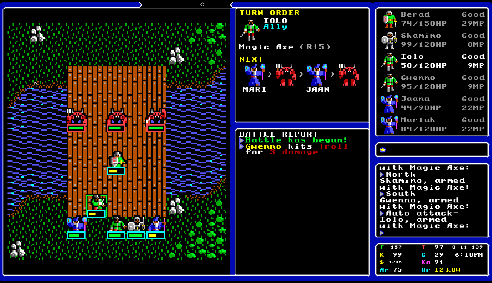
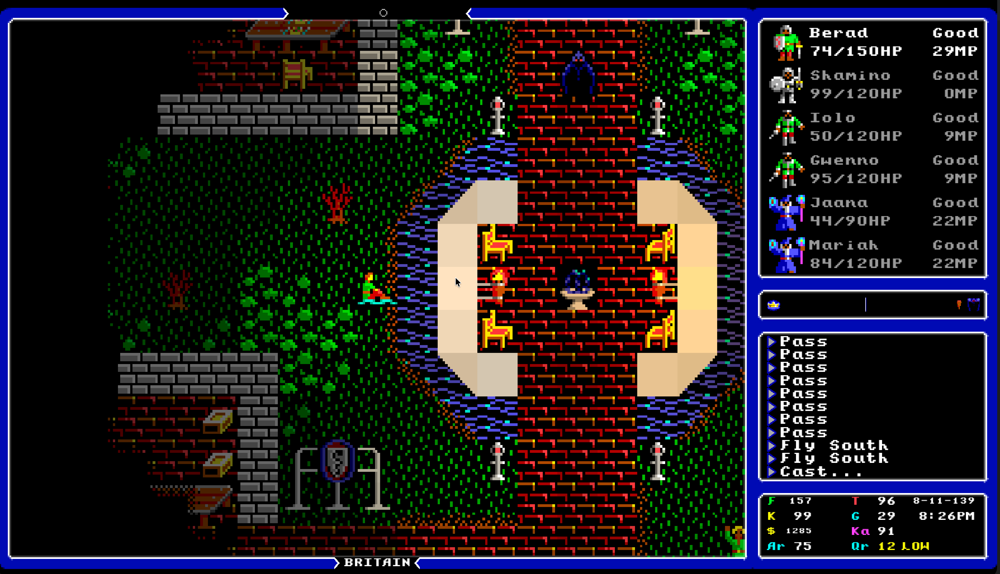
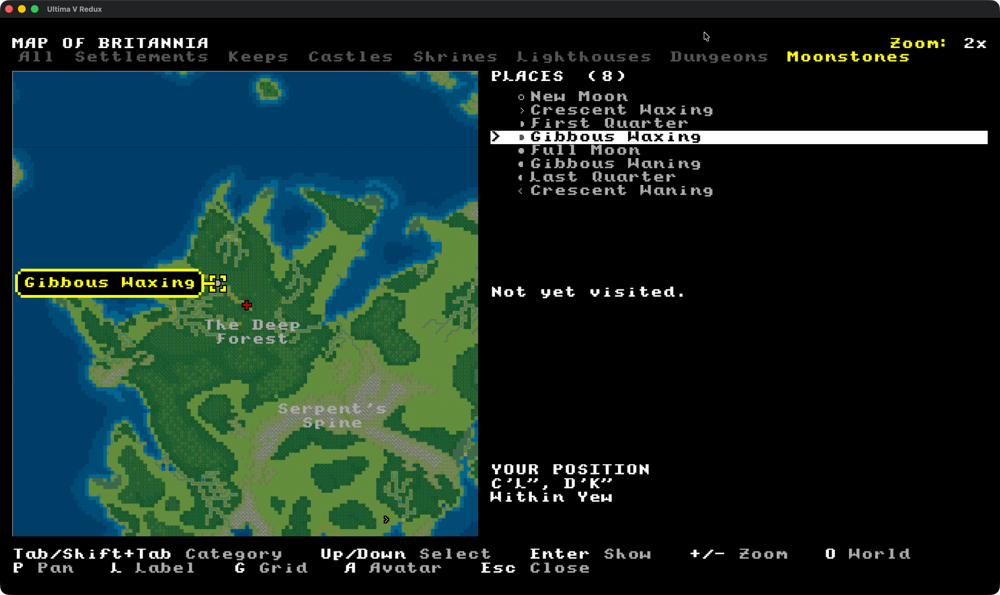

# Ultima V Redux

A modern Go recreation of **Ultima V: Warriors of Destiny**, with enhanced
presentation, quality-of-life improvements, and a developer Debug Workbench.
Playing requires files from your own copy of the original game.

> **Public development preview:** the source is available and the game can be
> installed from `main`. The application is unfinished and has known limitations.
> No version tag or packaged release has been published.

This is a free, non-commercial fan project. Project-authored source code remains
MIT-licensed; bundled media has separate terms described in [Asset credits](ASSET_CREDITS.md).

## A look at Britannia

Classic pixel art, a refreshed game interface, and a world to rediscover.
Select any screenshot to view it at full size.

<p align="center">
  <a href="docs/assets/2026-10-12_07-51-06.png">
    
  </a>
</p>

<table>
  <tr>
    <td align="center">
      <a href="docs/assets/2026-10-12_07-50-28.png">
        
      </a>
      <br><strong>Battle on the bridge</strong>
    </td>
    <td align="center">
      <a href="docs/assets/2026-10-12_07-52-13.png">
        
      </a>
      <br><strong>Britain after dark</strong>
    </td>
  </tr>
  <tr>
    <td align="center">
      <a href="docs/assets/2026-09-28_19-23-43.png">
        
      </a>
      <br><strong>Exploring West Winds</strong>
    </td>
    <td align="center">
      <a href="docs/assets/2026-10-02_20-29-50.png">
        
      </a>
      <br><strong>Mapping Britannia</strong>
    </td>
  </tr>
</table>

## Installation

Install the latest patch of **Go 1.27** or newer, then install and start the preview:

```sh
go install github.com/bradhannah/UltimaVRedux/cmd/ultimav@main
ultimav
```

Repeat the installation command to update. If `ultimav` is not found, see
[finding the executable](docs/INSTALL.md#start-the-game) for the `GOBIN`/`GOPATH`
fallback. The [installation guide](docs/INSTALL.md) also covers local builds,
original-game setup, and configuration recovery.

The preview targets macOS arm64 (Apple Silicon), Linux arm64, Linux amd64, and
Windows amd64. All four targets compile. Anonymous installation and bounded startup
were verified on Apple Silicon macOS. The maintainer also tested the game on macOS
and reported that it looks good. Native Linux and Windows testing is deferred and
their runtime behavior remains unverified; see
[installation acceptance](docs/INSTALL.md#installation-acceptance).
Players need Go, their original game files, and a desktop graphics/audio runtime.
Installation does not require a source checkout, Node, Make, or a C compiler.

## Original game files

First-run setup offers three practical routes:

1. Confirm a verified existing installation found through supported GOG/Heroic
   discovery or known local locations.
2. Copy your original game files into the **UltimaV** folder directly under your
   home directory, as shown by setup, then choose **Check Again**.
3. Choose **Open Settings File**, edit the game-data location in your text editor,
   save it, and choose **Check Saved Settings**.

Fresh configuration leaves the data location unset; setup asks for confirmation
even when it finds just one valid installation.
An already valid configured path is retained. The screen shows the resolved home
folder and settings filename; custom locations are entered in the external
settings editor. There are no in-game path fields. The game does not download
original assets for you.

To import a playthrough, the title menu reads `SAVED.GAM` and `SAVED.OOL` only
from the active game-data directory. For a save pair elsewhere, use the
[command-line save converter](docs/details/SAVE_CONVERTER.md).

## Reports and suggestions

The [Game Facts](docs/gamefacts/README.md) cover 39 topics with stable behavioral
IDs, algorithms, compatibility formats, and explicit Redux comparisons. See the
[documentation catalog](docs/README.md) for system contracts and the
[development guide](docs/DEVELOPMENT_GUIDE.md) for contributor setup.

Please [open an issue](https://github.com/bradhannah/UltimaVRedux/issues/new/choose)
for bugs, installation difficulties, behavioral corrections, or suggestions.
Include the game version, operating system, and steps to reproduce the problem.

The maintainer currently owns implementation. Please read
[CONTRIBUTING.md](CONTRIBUTING.md) and open an issue before preparing a code PR.

## License

Project-authored source is provided under the [MIT License](LICENSE). Bundled
fonts, media, and fixtures retain their accompanying notices and applicable
rights; their inclusion does not make all media MIT-licensed. The complete
original Ultima V installation needed to play is externally supplied by the
player. Original game material retains its existing rights.

See [Asset credits and media terms](ASSET_CREDITS.md) for the music sources,
font notices and individual sound-effect attribution, including non-commercial
media licences and remaining provenance limitations.
